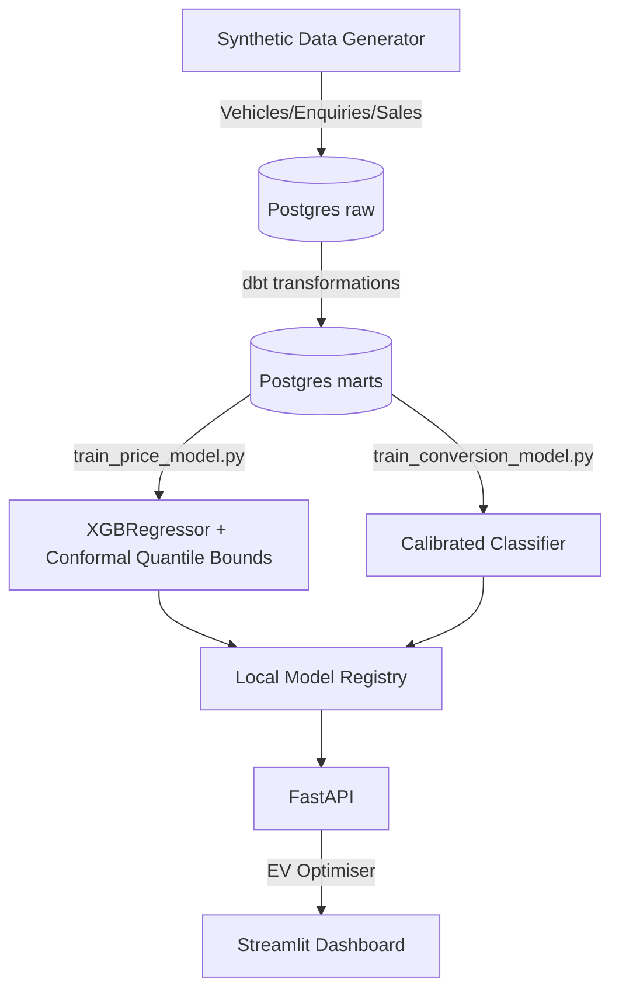

# AutoPricer – Vehicle Buy-Price Optimiser

[](https://github.com/Arshiamk/autopricer/actions)
[](https://opensource.org/licenses/MIT)

A production-style machine learning pricing system that optimises the trade-off between **margin** and **conversion volume** in a vehicle-buying business (e.g. Cazoo, Carvana, WeBuyAnyCar).

Most pricing repos stop at predicting the sale price. This system goes further: it builds a policy optimiser that combines expected margin, a predicted offer-to-win-probability curve, and tail-risk penalties to recommend a buy price that maximises **expected value**.

The system runs entirely on a synthetic auction dataset with a known data-generating process, which makes every model claim below reproducible from a clean checkout.

---

## Walkthrough / Repo Overview

See the [Walkthrough Document](walkthrough.md) for a phase-by-phase breakdown of the repository: how the synthetic data is generated with counterfactual offers, how the models are trained and calibrated, and how the offer optimiser works.

---

## Quickstart

The repository is dockerised and requires no external data downloads (it includes a synthetic auction generator).

```bash
cp .env.example .env
make setup generate features train
docker-compose up -d
```

- **Dashboard**: `http://localhost:8501`
- **API Docs**: `http://localhost:8000/docs`

---

## Architecture



---

## Screenshots and Example Output

### Dashboard


### Example API Call

Response from `POST http://localhost:8000/quote` for a 2019 BMW 3 Series (hybrid, 42,000 miles, dealer channel), using locally trained models:

```json
{
  "recommended_offer": 6254.88,
  "expected_value": 874.84,
  "p_win": 0.551,
  "risk_band": "medium",
  "explanation": {
    "e_sale": 8665.50,
    "e_costs": 400.0,
    "tail_penalty": 467.37
  }
}
```

---

## Model Strategy

1. **Sale-price model**: XGBoost regressor for E(sale price), with q10/q90 uncertainty bounds derived by split-conformal calibration of prediction ratios on a held-out set.
2. **Conversion model**: `HistGradientBoostingClassifier` wrapped in `CalibratedClassifierCV` (isotonic), trained with `offer_price` and an engineered `offer_to_value_ratio` feature so it learns genuine price elasticity.
3. **Counterfactual training data**: the generator emits multiple offers per enquiry across a wide offer/value range, so the offer-to-win curve is learned rather than confounded with vehicle value.
4. **EV optimiser**: grid search over feasible offers maximising `P(win|offer) x (E(sale) - offer - E(costs)) - lambda x tail_penalty`.

### Held-Out Metrics

Metrics on held-out test splits of the synthetic dataset (100,000 enquiries; reproduce with `make generate features train evaluate`, written to `reports/model_evaluation.json`):

| Metric | Value |
|---|---|
| Sale-price MAE | ~£1,900 |
| q10 bound empirical coverage | 0.102 (target 0.10) |
| Conversion ROC AUC | 0.849 |
| Conversion Brier score | 0.154 |

Exact values vary slightly per regeneration of the synthetic dataset.

---

## Monitoring & Drift Thresholds

Models degrade. The repo includes a monitoring pipeline (`pipelines/monitor/`, run with `make monitor`) that checks:

- **Population Stability Index (PSI)** and **KS tests** on key numeric features (e.g. `mileage`, `vehicle_age`, `offer_price`). Drift is flagged if `PSI > 0.25` or `KS p-value < 0.05`.
- **Performance tracking**: the current models are re-scored against the latest feature snapshot; an alert triggers if price MAE exceeds a configured threshold.
- **Alerting**: when either check fires, `reports/retrain_required.json` is written for CI orchestration.

---

## Limitations & Next Steps (Real-World)

If deployed against a real company's data, the immediate priorities would be:

1. **Actual CVaR**: replace the q10 tail penalty with a simulated Conditional Value at Risk drawn from realised margin distributions.
2. **Causal ML / Uplift**: move from generated counterfactuals to true uplift modelling (e.g. Double ML) to isolate the causal effect of price changes in observational data.
3. **Orchestration**: move the ingestion and monitoring scripts from Make targets into Airflow or Prefect.
4. **Feature store**: persist features into a low-latency store (e.g. Redis) to guarantee train-serve consistency at the API layer.

---

## Contributing

Contributions, issues, and feature requests are welcome.
See the [issues page](https://github.com/Arshiamk/autopricer/issues) and the [Contributing Guidelines](CONTRIBUTING.md).

---

## License

This project is licensed under the MIT License - see the [LICENSE](LICENSE) file for details.
